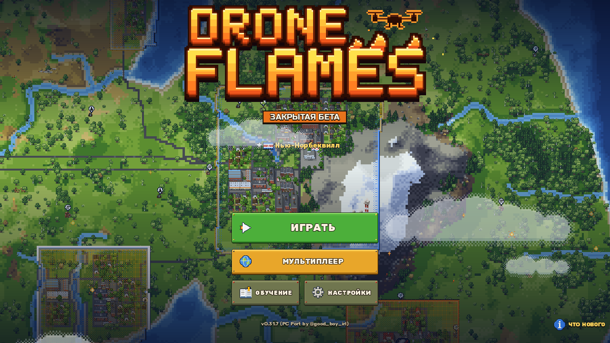
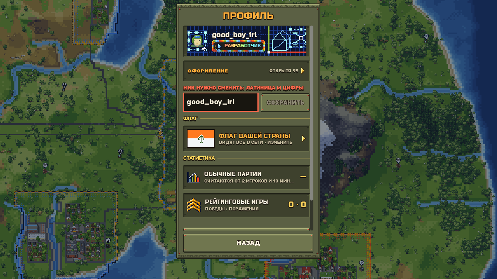
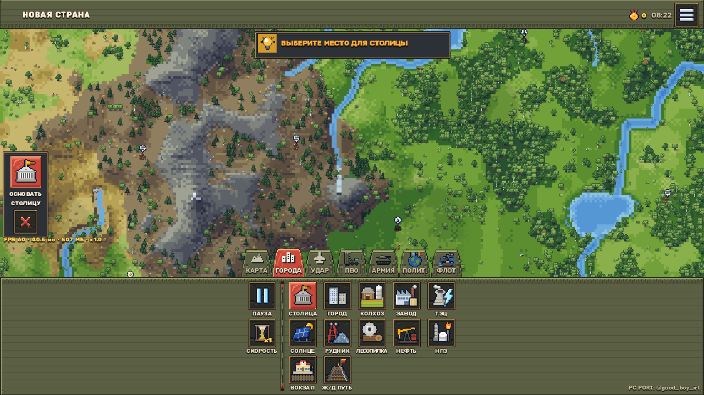
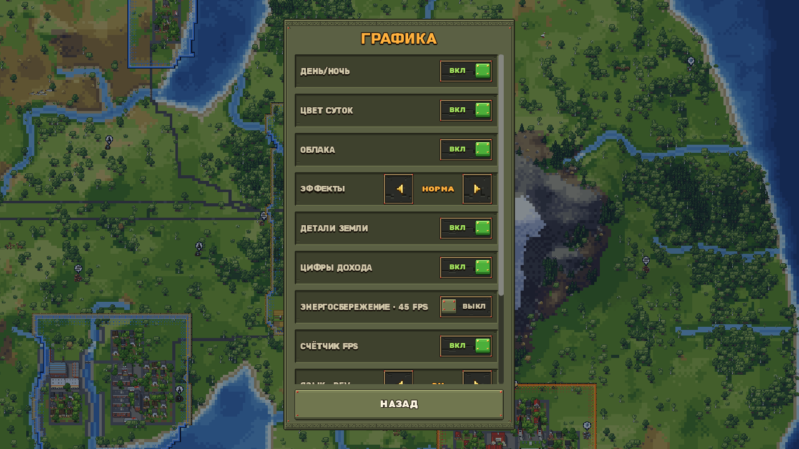

# 🎮 DroneFlames — PC Port by @droneflamesmod

[](https://github.com/makkaX2/DroneFlames-PC-Port/actions/workflows/build.yml)
[](https://github.com/makkaX2/DroneFlames-PC-Port/releases)
[](https://github.com/makkaX2/DroneFlames-PC-Port/releases)
[](https://t.me/droneflamesmod)
[](https://godotengine.org)
[](https://t.me/droneflamesmod)

> **Полноценный нативный кроссплатформенный порт игры DroneFlames на ПК (Windows x64, macOS Universal) и Android с открытым кодом, оптимизированным управлением и автоматической сборкой релизов.**

---

### 🏷️ Хэштеги / Topics
`#droneflames` `#pc-port` `#macos` `#apple-silicon` `#godot` `#godotengine` `#reverse-engineering` `#game-port` `#good_boy_irl` `#windows` `#rts` `#multiplayer` `#gaming`

---

## 🚀 Особенности порта (PC Features)

1. 🕹️ **Нативное ПК-управление и гибкая настройка клавиш (Keybinds System):**
   - **Меню переназначения управления** в `Настройки -> Управление: Клавиатура и мышь` с поддержкой назначения клавиш и кнопок мыши.
   - **Автоматическое сохранение** профиля управления в `user://keybinds.json` с кнопкой «Восстановить по умолчанию».
   - **WASD / Стрелочки**: плавное перемещение карты в бою.
   - **Перетаскивание карты средней кнопкой мыши (СКМ)** или правой кнопкой (ПКМ).
   - **Плавный скролл и зум колесиком мыши**: масштабирование без рывков к положению курсора.
   - **F11 / Alt + Enter**: мгновенное переключение в полноэкранный режим.

2. 🖥️ **Адаптивный ПК-интерфейс и широкоформатный HUD (Landscape 16:9):**
   - **Горизонтальный 1-строчный HUD** со стрелочками `<` и `>` для быстрой прокрутки каталога построек и юнитов.
   - **Плавающие модальные окна по центру экрана**: Дипломатия, Экономический хаб (склады, цепочки, доходы), Торговля и Статистика открываются центрированно, не перекрывая всю карту.
   - **Нижняя панель управления остаётся активной** даже при открытых окнах на ПК-экранах.
   - **Цифровая нумерация вкладок (`1`–`7`)**: мгновенная ориентация по горячим клавишам прямо на иконках HUD.
   - **Кнопки «Пауза» и «Скорость»** расположены бок о бок для быстрого переключения темпа игры.

3. ⌨️ **Быстрые бинды и горячие клавиши по умолчанию:**
   - `W, A, S, D` / `Стрелки` — Управление камерой
   - `Средняя кнопка мыши` / `ПКМ` — Перетаскивание карты
   - `P` / `Space` — Пауза / Возобновление боя
   - `F` / `Tab` — Переключение скорости игры (1x, 2x, 4x)
   - `1` – `7` — Быстрое переключение вкладок HUD (Карта, Города, Удар, ПВО, Армия, Полит., Флот)
   - `+` / `-` / `Колесо мыши` — Приближение и отдаление камеры
   - `Home` / `R` — Быстрое центрирование камеры на столице
   - `Esc` — Закрытие открытых модальных окон / отмена режима строительства

4. 🌐 **Сетевая игра для Windows (WebRTC Native):**
   - Интегрированы нативные библиотеки `libwebrtc_native.windows.template_release.x86_64.dll`.
   - Полноценная поддержка мультиплеера по LAN / Direct IP.

5. 🔄 **Встроенная система обновлений через GitHub Releases:**
   - Автоматическая проверка обновлений при старте игры через GitHub REST API.
   - **Окно «Обновление доступно»** в нативном военном стиле игры с возможностью обновиться в один клик или открыть страницу релиза.
   - Индикатор обновления в главном меню для повторного открытия.

6. 💬 **Telegram-сообщество портов и модов:**
   - Ссылка на неофициальное фанатское сообщество модов и портов в «Настройках» и «Что нового»: [t.me/droneflamesmod](https://t.me/droneflamesmod).
   - *Обратите внимание:* канал посвящён пользовательским модификациям и портам, не является официальным каналом разработчиков игры.

7. 🔓 **Разблокировка косметики и Dev Mode:**
   - Открыты все **118 предметов кастомизации** (титулы разработчика, RGB-рамки, аватары 2026, а также все 19 новых соревновательных титулов v0.33.4).
   - Включён **Developer Mode (`dev_mode`)** и оверлей **PERF PROBE** для мониторинга производительности и FPS.

8. ⚡ **Оптимизации производительности и энергосбережения:**
   - **Разрешение окна:** выбор стандартных разрешений до максимума монитора; меньший размер окна снижает нагрузку, полноэкранный режим остаётся чётким.
   - **Масштаб интерфейса:** автоматические 150% на 4K и 200% на 5K+, с ручным выбором от 80% до 200%.
   - **Шейдерная оптимизация дистанционного поля территорий v0.33.4:** ускорение отрисовки границ карты и существенное снижение нагрузки на GPU/CPU.
   - **Кэширование категорий тумана v0.33.4:** быстрый расчёт прозрачности спрайтов эффектов (`AnimatedSprite2D`).
   - **ПК-троттлинг в фоне:** снижение частоты кадров до 15 FPS при сворачивании игры или потере фокуса окна (Alt-Tab) для тихой работы кулеров и экономии батареи ноутбуков.
   - **Многопоточный воркер:** оптимизация `WorkerThreadPool` под многоядерные процессоры ПК для быстрой генерации карт и чанков.
   - **Графический движок Direct3D 12 (D3D12):** нативная поддержка современных видеокарт Windows; фактический FPS зависит от карты и нагрузки симуляции.

9. 🧩 **Система пользовательских модификаций (Modding System):**
   - Нативная поддержка модов `.dfmod` и папок с модами в `mods/`.
   - Встроенный визуальный **Менеджер модов** в главном меню с поддержкой включения/отключения, настроек и деталей каждого мода.
   - Моды: ВДВ, танковый завод, кассетные ПТРК, тактический ядерный удар, расширение городов, подвес КАБ для истребителей, повторная постройка, центр улучшений, Discord Rich Presence, карты и сценарии, БПЛА «Герань-2».

9. 🎬 **Сохранение аутентичности и оригинального интро DroneFlames:**
   - Полностью сохранены оригинальное интро-видео, экран заставки и брендинг игры без чужих подмен.
   - Отметка автора ПК-порта `@good_boy_irl` в углу экрана и информации о версии.

---

## 💬 Сообщество и Telegram-канал

> ⚠️ **Важно:** Данный Telegram-канал посвящён неофициальным ПК-портам и фанатским модификациям (модам) игры. Это не официальный канал разработчиков оригинальной игры DroneFlames.

* 📢 **Telegram-канал портов и модов:** [t.me/droneflamesmod](https://t.me/droneflamesmod)

---

## 📦 Быстрый запуск

* **Играть без установки:** запустите `Play_DroneFlames.bat`.
* **Запуск с отладочной консолью:** запустите `Play_DroneFlames_Debug.bat`.
* **Установка инсталлером:** скачайте готовый `DroneFlames_PC_Setup_v0.33.4.9_good_boy_irl.exe` из [Releases](https://github.com/makkaX2/DroneFlames-PC-Port/releases).

---

## 🤖 Автоматическая сборка (GitHub Actions CI/CD)

В репозитории настроен автоматический CI/CD пайплайн (`.github/workflows/build.yml`):
* При любом изменении кода и пуше в `master` / `main` автоматически:
  1. Собирается переносимый архив **Windows Portable ZIP** (`DroneFlames_PC_v0.33.4.9_good_boy_irl.zip`).
  2. Через **Inno Setup 6** компилируется полноценный установщик **Windows Setup EXE** (`DroneFlames_PC_Setup_v0.33.4.9_good_boy_irl.exe`).
  3. Собирается нативная **macOS Universal** сборка (Apple Silicon M-серии + Intel) в виде установщика **macOS DMG** (`DroneFlames_macOS_v0.33.4.9_good_boy_irl.dmg`) и переносимого **macOS ZIP** (`DroneFlames_macOS_v0.33.4.9_good_boy_irl.zip`).
  4. Собирается **Android APK** с актуальным кодом.
  5. Создаётся или обновляется релиз во вкладке **Releases**, куда загружаются готовые файлы под все платформы.

---

## 🛠️ Локальная сборка билдов

Если вы хотите собрать инсталлер и zip локально на своём компьютере:

```bat
# Способ 1: в один клик
build_installer.bat

# Способ 2: через Python
python build.py
```

Готовые файлы появятся в папке `dist/`:
- `dist/DroneFlames_PC_Setup_v0.33.4.9_good_boy_irl.exe`
- `dist/DroneFlames_PC_v0.33.4.9_good_boy_irl.zip`

---

## 📂 Структура репозитория

```text
DroneFlames-PC-Port/
├── .github/workflows/      # Автоматический CI/CD сборки и релизов
├── addons/                 # Модули Godot (WebRTC Native DLLs, Device plugins)
├── assets/                 # Аудио, спрайты, шрифты, шейдеры
├── core/                   # Базовая логика игры
├── dev/                    # Скрипты разработки
├── game/                   # Игровые сцены и main.gd (с биндами и WASD)
├── net/                    # Мультиплеер, автоапдейтер, аккаунты
├── translations/           # Локализация
├── ui/                     # Интерфейс, HUD, меню, косметика
├── world/                  # Генерация мира и map_camera.gd (плавный зум/камера)
├── screenshots/            # Скриншоты геймплея
├── tools/                  # Утилиты и скрипты поддержки
├── app_icon.ico            # Иконка приложения
├── build.py                # Скрипт сборки ZIP и Inno Setup инсталлера
├── build_installer.bat     # Батник для быстрой сборки инсталлера
├── DroneFlames.exe         # Нативный исполняемый файл Windows
├── DroneFlames_Debug.exe   # Отладочный исполняемый файл
├── export_presets.cfg      # Пресеты экспорта Godot 4.3 (Windows & Android)
├── installer.iss           # Скрипт Inno Setup 6
├── Play_DroneFlames.bat    # Лаунчер игры
├── project.godot           # Главный конфигурационный файл Godot 4.x
├── watermark.gd            # Полноэкранный режим и ватермарка
└── README.md               # Документация проекта
```

---

## 📸 Скриншоты

| Главное меню с версией и ватермаркой | Профиль разработчика и косметика |
|:---:|:---:|
|  |  |

| Геймплей и телеметрия | Меню настроек Dev Mode |
|:---:|:---:|
|  |  |

---

## 👤 Авторство и благодарности

* **Автор ПК-порта и модификаций:** `@good_boy_irl`
* **Оригинальная игра:** DroneFlames (`com.kolesnyk.droneflames`)
* **Движок:** Godot Engine (v4.3+ / v4.7)
